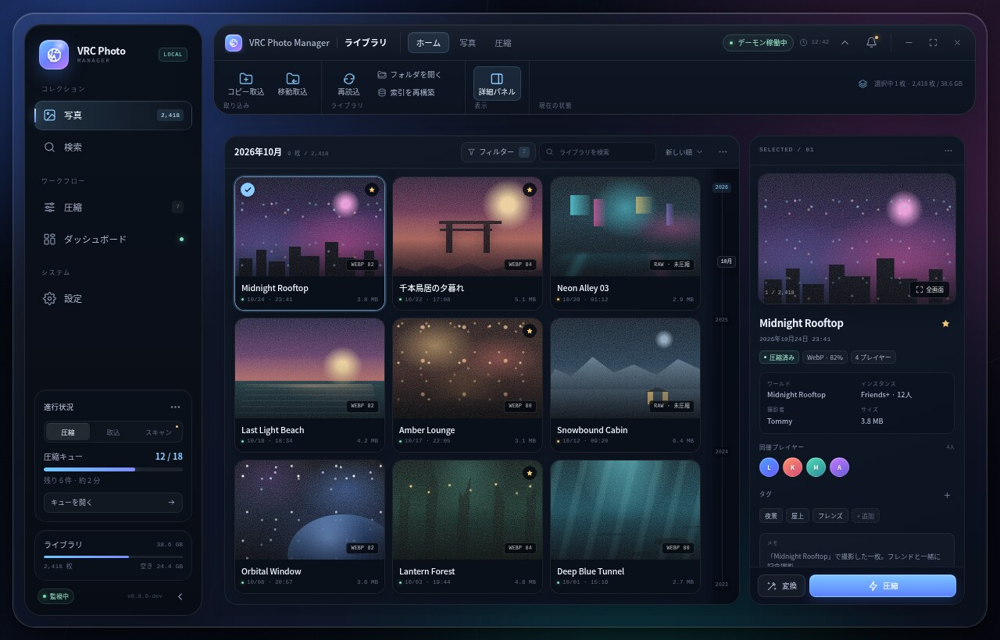

# ガラス背景リボンUI 詳細設計

- Date: 2026-10-27
- Status: 実装前・方向確定
- Mock: [docs/ui-glass-ribbon-mockup.html](../../ui-glass-ribbon-mockup.html)
- Screenshots: [assets/glass-ribbon](assets/glass-ribbon/)
- Target: `crates/ui`, `crates/core`（設定1項目）, `docs/ui.md`
- 関連: [#27 UI刷新](https://github.com/TommyZ-7/vrc-photo-manager/issues/27) の後継差分。カスタムタイトルバー/リボン統合とUIファイル分割を追加する。



*モックのLibrary画面。ブラウザ上のデスクトップ枠はプレゼンテーション用で、実装ではOSウィンドウ内にアンビエント層を描く。*

## 1. Intent

`crates/ui/src/main.rs` は14,833行・134テストを持つ単一ファイルで、画面見出し・リボン・設定コマンドが重複している。写真を主役にするため、**ウィンドウ背景だけをガラス調**にし、サイドバー・ヘッダー・本コンテンツは不透明なパネルカードで分離する。さらにヘッダーをカスタムタイトルバーとリボンに統合し、ページ見出しを廃止して本コンテンツを最大化する。

この設計の主目的は次の2つ。

1. **UIの再構成**: ガラス調の背景、不透明なカード群、統合タイトルバー、3グループ常時表示のコンパクトリボン、見出しのないカード主体の画面。
2. **保守性の回復**: `main.rs` を責務単位のモジュールへ分割し、画面追加・修正時に14,000行のファイルを触らなくてよい状態にする。

## 2. Current state

- UIは `gpui-kit 0.8.0`（`gpui-pre 0.3.9`）固定。直接 `gpui` を依存に追加しない。
- ネイティブタイトルバー。ウィンドウ最小サイズは 1080×700、既定は 1280×820（`--window-size` で変更可）。
- 画面は Photos / Search / Compression / Dashboard / Settings。各画面が72pxの `screen_header` を持つ。
- リボンは「ホーム / 写真 / 圧縮 / 表示 / ツール」の5タブ。表示・ツールには設定画面と重複するコマンドがある。
- 写真グリッドは `uniform_list`、固定行高196px、画像128px、最小カード幅170px。年レールのジャンプ計算もこの行高に依存する。
- 設定は `AppSettings`（SQLiteの `app_settings` JSON）に保存。`ui_sidebar_collapsed` / `ui_inspector_collapsed` / `ui_reduce_motion` は既存。
- テストは `crates/ui/src/main.rs` の `#[cfg(test)] mod tests` に集中している。

## 3. Goals

### 3.1 UI

- ウィンドウ**背景のみ**をダークなガラス面として扱う。環境光（アンビエント）は背景に置き、カードは不透明パネルとして写真の可読性を優先する。
- 左はサイドバーカードのみ。右は「タイトルバー＋リボン」ヘッダーカードと、本コンテンツの内部カード。
- 本コンテンツのページ見出し（タイトル・件数・フィルター行）を全画面で削除し、内部カードを上端から最大化する。
- 最上部1行目に `VRC Photo Manager`、現在画面名、リボン折りたたみ、通知ベル、ウィンドウ操作を統合する。
- リボンは **ホーム / 写真 / 圧縮** の3グループを常時表示し、高さ68px（高さ760px以下では62px）。
- 設定固有のコマンド（背景のガラス強度・モーション・テーマ・ログ・更新・バージョン・ショートカット）はリボンから外し、設定画面へ寄せる。
- 再読込・詳細パネル・取り込み・フォルダ・索引再構築など、画面ローカルだった操作をリボンへ移す。
- ライブラリの絞り込み・並びはギャラリーカード内ヘッダーへ移す。検索は既存のSearch画面を維持する。

### 3.2 Architecture

- `main.rs` をエントリポイント（CLI、ウィンドウ生成、グローバルアクション、モジュール宣言）に縮小する。
- `App` の状態・ライフサイクルと、画面・共通部品・状態型を分離する。
- 画面ごとの `impl App` とテストをそのモジュールへ移す。
- これは **挙動を変えない分割PR** と **UI変更PR** に分ける。分割PRの時点で見た目は現行UIのままにする。

## 4. Non-goals

- ライブラリ内のインライン検索、新しい検索/絞り込み/並び替えロジック。
  - 既存のフィルターチップは現在も外観のみ。今回も外観のみで、検索画面の実検索を置き換えない。
- 写真グリッドのリスト表示（モックのみ。実装はグリッド固定）。
- 背景のガラス強度3段階、年レール表示トグル（モックのみ。必要なら別Issue）。
- ライトテーマ、テーマ切替、要素単位の本物のbackdrop blur。
- コア/デーモンのデータモデル変更、画像デコード経路の追加。
- Windows実機の表示確認（#9へ委譲）。
- リリース・パッケージ形式の変更。

## 5. Approved decisions

| 項目 | 決定 |
|---|---|
| ページ見出し | 全画面で削除。タイトルはタイトルバーの現在画面名へ |
| リボン | ホーム / 写真 / 圧縮 の3グループ（常時表示） |
| 最上部1行目 | アプリ名＋現在画面名＋折りたたみ/通知＋ウィンドウ操作 |
| リボン高さ | 68px、高さ760px以下で62px |
| 設定コマンド | リボンから外し、設定画面へ |
| 再読込/詳細/取り込み | リボンへ |
| ライブラリのフィルター/並び | ギャラリーカード内ヘッダーへ |
| リボン折りたたみ | `ui_ribbon_collapsed` として永続化 |
| ファイル分割 | 先に挙動不変の分割PR、その後UI変更PR |
| モック外観 | ガラス調の背景＋不透明な3エリアカード＋内部カード主体を採用 |

## 6. Mock interpretation

モックのブラウザ表示はプレゼンテーション用の枠であり、実装対象ではない。

- モックのデスクトップ壁紙・浮遊ウィンドウのドロップシャドウ・角丸は、実装ではOSウィンドウそのものになる。
- 実装ではウィンドウ内にアンビエント層（暗いグラデーション＋色付きグロー）を描き、その上に**不透明なカード**を置く。カードの背後にだけガラス背景が見える。
- モックのウィンドウ操作アイコンは `gpui-component::TitleBar` の標準コントロールを使う。独自の偽ボタンは描かない。
- モックのCSS `backdrop-filter` は実装できない。ウィンドウ全体のblur（対応環境）＋アンビエントを背景に限定し、カードは不透明なパネル色と境界・影で分離する。
- モックの写真はCSSアートのプレースホルダー。実装では実サムネイル/プレビューを使う。
- モックのトーストはデザイン確認用。実装では既存の `App.message` をリボン右側のステータス領域に出す。

### 6.1 モックのみ・今回の対象外

- ライブラリ内のインライン検索欄 → 既存Search画面と `Ctrl/Cmd+K` を使う。
- リスト表示切替 → グリッド固定。
- 背景のガラス強度（控えめ/標準/濃い）と年レール表示トグル → 実装しない。
- フィルターの実動作、検索結果の追加データ、モックのダミー枚数/プレイヤー。
- モックのウィンドウ外観（壁紙、影、OS枠）。
- モックのトースト自動消去。
- ダッシュボードの「…」など、実体のないメニュー。

## 7. GPUI constraints and fallback

### 7.1 Custom titlebar

`gpui-component 0.8.0` の `TitleBar` を使う。

- `TitleBar::window_options()` を土台に `WindowOptions` を作る。
- `TitleBar::title_bar_options()` で `appears_transparent: true` を設定する。
- Linuxでは `window_decorations: Some(WindowDecorations::Client)` を要求する。Wayland/X11の compositor が許可しない場合はサーバー側装飾にフォールバックし、`TitleBar` はウィンドウコントロールを描画しない。この場合もアプリ内のタイトルバー行（タブ・状態）は残す。
- Windows/macOSではネイティブタイトルバーを隠し、`TitleBar` のコントロールを使う。macOSの信号機位置は `TitleBar` に任せる。
- タイトルバー高さは46px。`TitleBar` は既定34pxなので、スタイルで46pxへ上書きできることを最初に確認する。上書きできない場合は `TitleBar` の内側バーに合わせてヘッダーカードの高さを調整し、無理に独自コントロールを実装しない。
- タイトルバー内のタブ・ボタンがクリックできること、ドラッグ・ダブルクリック最大化・右クリックのウィンドウメニューが壊れないことを手動確認する。

### 7.2 Window glass

- `WindowBackgroundAppearance::Blurred` を要求する。Windows 11でMicaを使うかは任意。Linux compositor がblurを拒否する場合がある。
- **要素単位のblurは使わない**。`WindowBackgroundAppearance` はウィンドウ全体だけ。
- ルートにアンビエント層を描く。GPUIはradial gradientを持たないため、暗い `linear_gradient` と、大きな半透明の丸/ぼかしに見える `box_shadow` で近似する。
- **カードは不透明**。`PANEL_SIDEBAR` / `PANEL_HEADER` / `PANEL_CARD` / `PANEL_INNER` などのソリッド色、1pxの境界、上辺のinset highlight、弱いドロップシャドウで分離する。カードに `backdrop-filter` 相当を適用しない。
- ガラスは背景（ウィンドウ地、アンビエント、ページ見出しを削除した余白）だけに限定する。写真・メタデータ・設定カードの可読性を半透明に依存させない。
- 背景が完全不透明になる環境でも、アンビエント層＋不透明カードのコントラストで読めること。壁紙が見えること自体を要件にしない。
- 透過/ブラーが使えない場合のフォールバックを必ず確認する（Linux X11 compositorなし、Waylandのblur非対応など）。背景のアンビエントは常に描く。

### 7.3 Rendering and performance

- 既存の `uniform_list`、サムネイルLRU、プレビューキュー、3秒polling、IPCを維持する。
- アニメーションのフレームでDBクエリや画像デコードを実行しない。
- GPUIにはCSS transformがない。幅・opacity・小さなoffsetのみで動かす。`prefers-reduced-motion` 相当の既存設定を尊重する。
- 3:2カードへ変更する場合、`uniform_list` の行高は列幅から計算する。行高は同一フレーム内の全行で一定にし、リサイズ時だけ再計算する。
- 年レールのジャンプは行高・列数に依存するため、同じ helper を使う。

### 7.4 Fonts and platform

- Noto Sans JPをバンドル継続。Latinはsystem UIフォールバック。
- 最小1080×700、既定1280×820、最大幅は現状のウィンドウ挙動を維持。
- Windows実機は対象外。Linux（X11/Wayland）で確認する。

## 8. Layout

### 8.1 Structure

```text
OS window (Blurred/Transparent request)
└─ root ambient layer (dark linear gradient + soft glows)
   └─ 14px padding, 14px gap
      ├─ Sidebar card (expanded 238 / collapsed 78)
      └─ Main column
         ├─ Header card
         │  ├─ Titlebar 46px: app / screen / tabs / status / controls
         │  └─ Ribbon 68px (62px at height <=760)
         └─ Content area (transparent, no outer card)
            └─ Active screen (12px/14px padding)
               └─ Inner cards (gallery/inspector, filter/results, profile/editor, ...)
```

- コンテンツ領域に外側カードを置かない。画面ごとの内部カードだけを描く。
- ヘッダーカードと本コンテンツの間隔は14px。画面内のカード間隔は12px。
- サイドバー幅は既存の238/78を維持する（モックの248/228/214は参考値）。ただし1280pxで3列を保つため、インスペクタ列は298px、1280pxでは276px、1080pxでは254pxを目安に調整する。
- タイトルバー行はウィンドウ全幅ではなく、サイドバーの右側のヘッダーカード内に置く。左側のサイドバーカードは上端から下端まで。

### 8.2 Responsive

| 幅 | サイドバー | ライブラリ列 | インスペクタ | リボン |
|---|---:|---:|---:|---:|
| 1440×900 | 238 | 3 | 298 | 68px |
| 1280×820 | 238 | 3 | 276 | 68px |
| 1080×700 | 238 or 78 | 2 | 254 | 62px |
| <=1060 | 78 | 2 | 非表示 | 62px |

- 高さ760px以下でリボン62px、サイドバーの進行状況カードは省略（既存挙動を踏襲）。
- 幅1180px以下でリボン右側の状態ノートを隠す。幅1060px以下でサイドバーをレール化し、インスペクタを隠す既存挙動を維持する。
- どのサイズでも横スクロールを出さない。

## 9. Visual system

### 9.1 Tokens

既存の定数名を維持しつつ、背景ガラス用のalpha色と、不透明カード用のパネル色を追加する。

| Token | Value | Use |
|---|---|---|
| `BG` | `#05070d` | 最暗部 |
| `BG_AMBIENT_A` | `rgba(54,107,255,0.28)` | 左上の青いグロー |
| `BG_AMBIENT_B` | `rgba(255,86,181,0.12)` | 右上の紫グロー |
| `BG_AMBIENT_C` | `rgba(30,202,178,0.10)` | 下部のティールグロー |
| `GLASS_WINDOW` | `rgba(10,16,28,0.38)` | ウィンドウ背景（唯一のガラス面） |
| `PANEL_SIDEBAR` | `#0b111b` | サイドバーカード |
| `PANEL_SIDEBAR_DEEP` | `#080d15` | サイドバー下部 |
| `PANEL_HEADER` | `#101725` | タイトルバー/リボンカード |
| `PANEL_CARD` | `#0d1420` | 大カード |
| `PANEL_INNER` | `#111927` | 内部カード |
| `PANEL_INNER_DEEP` | `#0c1320` | 内部カード下部 |
| `PANEL_DEEP` | `#0a1019` | 入力/メタ情報/小カード |
| `PANEL_RAISED` | `#172132` | ホバー/選択補助 |
| `BORDER` | `rgba(255,255,255,0.105)` | カード境界 |
| `BORDER_STRONG` | `rgba(255,255,255,0.17)` | hover/focus |
| `TEXT` | `#eef4ff` | 本文 |
| `MUTED` | `#a8b4ca` | 副次 |
| `MUTED_2` | `#7f8ba3` | ラベル |
| `BLUE` | `#8bcbff` | アクセント |
| `BLUE_2` | `#7f92ff` | アクセント2 |
| `GREEN` | `#7ee2b8` | 稼働/完了 |
| `AMBER` | `#f4c878` | 待機/注意 |
| `RED` | `#ff94a8` | エラー |
| `PURPLE` | `#c49bff` | 補助 |

- 角丸: ウィンドウ内カード22px、内部カード17px、写真カード13px、ボタン7-8px、ピル999px。
- 影: カードに `0 18px 44px rgba(0,0,0,0.28)`、上辺に白のinset highlight。強いドロップシャドウを多用しない。
- アンビエントのグローはカードの背後（背景）に置き、カード内の文字コントラストを下げない。
- カードは不透明。境界・影・パネル色の差で階層を作り、背景のガラスをカード内に透かさない。

### 9.2 Typography

- 基本12px。ラベル/メタデータは7.5-10px、画面内の主要数値は20-22px、カードタイトルは13-15px。
- 画面見出しは削除するため、24pxのページタイトルは使わない。
- 等幅は時刻・件数・パスに限定する。
- ボタンはテキスト優先。アイコンはナビゲーションとツールバーに限定する。

## 10. Titlebar and ribbon

### 10.1 Titlebar line

左から:

1. アプリグリフ（22px）
2. `VRC Photo Manager`（11px、muted）
3. 区切り
4. 現在画面名（`Screen::title()`、11.5px、text）
5. 右寄せ: リボン折りたたみ、通知ベル、ウィンドウ操作

- リボンはタブを持たず、ホーム / 写真 / 圧縮の3グループを常時表示する。
- `Ctrl/Cmd+B`（サイドバー）、`Ctrl/Cmd+I`（詳細）、`Ctrl/Cmd+K`（検索）は既存の挙動を維持する。
- リボン折りたたみは `ui_ribbon_collapsed` として保存する。起動時に復元する。

### 10.2 Command inventory

**ホーム**

| グループ | コマンド | 動作 |
|---|---|---|
| 取り込み | コピー取込 / 移動取込 | `open_import_dialog(ImportMode::Copy/Move)` |
| ライブラリ | 再読込 | コンテキストに応じ `reload_library(preserve_anchor=true)` / `reload_aux()` |
| 表示 | カードサイズ / 詳細パネル | カード密度の切替。`toggle_inspector` |

**写真**

| グループ | コマンド | 動作 |
|---|---|---|
| 選択 | すべて選択 / 選択解除 | 既存の複数選択 |
| 整理 | ゴミ箱へ / 圧縮 | 既存の2段階削除・手動圧縮 |

**圧縮**

| グループ | コマンド | 動作 |
|---|---|---|
| 圧縮 | 指定フォルダ / プロファイル先 / クリップボード / 待機を圧縮 | 選択中の写真をその出力先へ圧縮・キュー解放 |

**リボンから外す**

- 表示タブの背景ガラス強度・モーション・テーマ。
- ツールタブのログ・更新確認・バージョン情報・ショートカット。
- これらは設定画面の既存コントロールへ寄せる。ログは設定のログカード、更新/バージョンは既存のアップデートUI、ショートカットは設定のAbout相当の行に表示する。
- サイドバーの開閉はサイドバー下部の既存トグルと `Ctrl/Cmd+B` に残す。
- リスト表示は実装しない（非ゴール）。

## 11. Screen specifications

### 11.1 Library

- ページ見出しを置かない。コンテンツはギャラリーカードとインスペクタカードの2枚。
- ギャラリーカードのヘッダー（42px）:
  - 左: `2026年10月` と `9枚 / 2,418`（実際の月・件数）。
  - 右: 「フィルター」ボタン、ソート表示、その他。
  - フィルターボタンは既存の4フィルターチップ（ワールド/プレイヤー/日時/タグ）をポップオーバーで表示する。**フィルタリング処理は追加しない**。チップの外観のみ既存仕様を維持する。
  - ソートは既存の「並び: 新しい順」表示のみ。新しいソート処理は追加しない。
  - インライン検索欄は置かない。検索はSearch画面/Ctrl+K。
- グリッド:
  - カードは3:2画像＋タイトル/日時/サイズ。最小幅190px、gap 9px。
  - 1440/1280で3列、1080で2列。1440/1280では9枚が3×3で収まる高さを基本にする。
  - `uniform_list` の行高は `photo_row_height(card_width)` で算出する。`PHOTO_ROW_HEIGHT` の固定値を直接使わない。
  - 年レールのジャンプ/スクロール計算も同じ行高 helper を使う。
  - 選択リング、チェック、favorite、圧縮状態、未紐付け、ホバー浮上、既存の選択範囲は維持する。
  - カードイントロは既存の初回24枚/最大8段を維持し、スクロール再マウントで再生しない。
- インスペクタ:
  - 幅は上表。プレビューは16:10を維持し、高さは168px（短いウィンドウでは118px）。
  - タイトル、日時、圧縮バッジ、メタデータ、同接プレイヤー、タグ、メモ、全画面/圧縮アクションを維持する。
  - 既存の平均色tint/クロスフェード/フォーカス順を壊さない。
- 条件付き要素:
  - 複数選択バーはギャラリー上に条件表示。
  - 取り込み結果パネルはギャラリー上に条件表示。サイドバーの「結果を見る」から到達できること。
  - ライブラリ索引/ページ読込エラーはギャラリー上に再試行付きで表示。
  - グローバル失敗アラートはコンテンツ最上部に細い行で表示。ページ見出しの削除で失わない。
- 空/読み込み/失敗状態の案内は既存文言・再試行を維持する。

### 11.2 Search

- ページ見出しを削除。左のフィルターカードと右の結果カードのみ。
- フィルターカードの入力・日時プリセット・お気に入り・検索/クリア/保存は既存のまま。
- 結果カードのヘッダーに件数、検索中表示、`message`、選択バー、ソート表示を集約する。
- 結果グリッドは3:2カード。`uniform_list` の行高をライブラリと同じ helper で計算する。
- 年レール、複数選択、一括圧縮、ビューア起動、タグ編集後の再検索を維持する。

### 11.3 Compression

- ページ見出しを削除。左プロファイル一覧カード、右エディタカード。
- プロファイル追加は一覧カードのヘッダーに残す。手動圧縮はリボンの写真グループ「圧縮」。
- 形式・品質・ロスレス・リサイズ・出力・自動適用・複製/削除・統計を維持する。
- キューはDashboardの共有キューを維持し、この画面には新規キューUIを追加しない。

### 11.4 Dashboard

- ページ見出しを削除。統計4枚、共有圧縮キュー、デーモン、現在セッションを内部カードで表示。
- 高さが余る場合はキューカードと右カラムを内容領域いっぱいに伸ばす。データが少ないときもカードの外枠は崩さない。
- 再スキャン/一時停止/終了、ログ、エラー、監視パス、24時間注意は既存のカード/操作を維持する。ヘッダーの「再読込」はホームの再読込またはデーモンカードの小さな更新に寄せる。
- デーモン操作はリボンを増やさないため、原則Dashboardのデーモンカードに残す。

### 11.5 Settings

- ページ見出しを削除。左カテゴリナビカード、右設定カード。
- 既存のライブラリ/起動/圧縮/表示/ログ/更新の設定を維持する。
- ナビカード上部に「設定」ラベルと「再読込」を置いてもよい。既存の「設定を再読込」動作を失わない。
- 背景のガラス強度・年レール表示トグルは今回追加しない。モックの該当行は実装しない。
- 自動保存・パス保存・カードサイズ・モーション設定など既存挙動を維持する。

### 11.6 Viewer and dialogs

- フルスクリーンビューア、手動圧縮ダイアログ、取り込みモーダル、削除確認の**挙動**は変更しない。
- 背景のガラスに合わせて、オーバーレイのscrim、カードの不透明パネル色、角丸、境界、余白を調整する。
- ビューアのフォーカストラップ、Esc、左右移動、詳細パネル、ゴミ箱後のクローズを維持する。
- 操作の結果や失敗はトーストと通知モーダルで知らせる。失敗の詳細は従来どおり各画面に残す。

### 11.7 Global alerts and messages

- 失敗の通知は通知モーダルに集約する。タイトルバーの通知ベルにドットを出し、モーダルから対象画面へ移動できる。
- 一過性の結果はトーストで出す。失敗系のトーストはクリックで通知モーダルを開く。

### 11.8 Visual references

- [Library 1440×900](assets/glass-ribbon/library-1440.jpg)
- [Search 1280×820](assets/glass-ribbon/search-1280.jpg)
- [Compression 1280×820](assets/glass-ribbon/compression-1280.jpg)
- [Dashboard 1280×820](assets/glass-ribbon/dashboard-1280.jpg)
- [Settings 1280×820](assets/glass-ribbon/settings-1280.jpg)
- [Viewer 1440×900](assets/glass-ribbon/viewer-1440.jpg)

## 12. State and behavior

### 12.1 New/changed state

```rust
enum RibbonTab { Home, Photo, Compression }

// App
ribbon_collapsed: bool,       // persisted as ui_ribbon_collapsed
```

- `AppSettings` に `#[serde(default)] pub ui_ribbon_collapsed: bool` を追加する。既定は `false`。
- 既存JSONにフィールドがなくても他の設定を失わないテストを追加する。
- リボンの3グループは常時表示で、画面や選択に応じた有効 / 無効だけが変わる。タブ選択の状態は持たない。

### 12.2 Preserved interactions

- サイドバー開閉/保存、インスペクタ開閉/保存、縮小表示、ナビツールチップ。
- 写真選択（単一/Ctrl/Shift）、選択バー、一括圧縮、検索、タグ、メモ、favorite、ゴミ箱、ビューア。
- 取り込みのコピー/移動、再試行、再開、結果パネル、IPC wake。
- 圧縮プロファイル、手動圧縮、出力先/元画像ポリシー、待機キュー、失敗retry、デーモン操作。
- 3秒自動更新、IPCイベント、更新確認、トレイ/自動起動。
- 既存のキーボードショートカットとフォーカストラップ。
- 画像デコード/DBクエリの回数を増やさない。

## 13. UI module split

### 13.1 Target tree

```text
crates/ui/src/
  main.rs                     # modules, main(), window options, global actions
  app.rs                      # App struct, new(), render(), pub(crate) fields
  app/
    lifecycle.rs              # refresh, IPC, daemon, reload, screen switching
    photos.rs                 # selection, preview/thumbnail requests, library data
    viewer.rs                 # full-screen viewer open/close/navigation/focus
    search.rs                 # search execution and result application
    import.rs                 # import run orchestration
    compression.rs            # profile/manual-compression operations
    daemon.rs                 # daemon controls/log actions
    demo.rs                   # demo assets/seed
    cli.rs                    # LaunchOptions/parse_args/timing
  state/
    mod.rs
    preview.rs                # PreviewKey/PreviewQueue/cache path helpers
    thumbnail.rs              # ThumbnailCache/decode_thumbnail
    photo_browser.rs          # PhotoIndex/PhotoPageCache/PhotoBrowser/CountDebounce
    year_rail.rs              # YearBucket, rail math, YearRail element
    viewer.rs                 # ViewerMorph/ViewerBoxState/ViewerPanelState/geometry
  ui/
    mod.rs
    actions.rs                # actions! and shared UI actions
    theme.rs                  # tokens, metrics, colors, motion, pure layout helpers
    shell.rs                  # root, ambient, sidebar, rail toggle, content dispatch
    chrome.rs                 # titlebar + ribbon
    components.rs             # panel surfaces (旧glass_panel), buttons, chips, badges, meta rows
    library.rs                # Photos screen, grid, inspector
    year_rail.rs              # YearRail element/labels (pure math lives in state/)
    search.rs
    compression.rs
    dashboard.rs
    settings.rs
    import.rs                 # import modal/report
    viewer.rs                 # full-screen viewer/morph overlay
    dialogs.rs                # manual compression/delete/confirm overlays
  ipc_bridge.rs
  logging.rs
  update_view.rs
```

### 13.2 Boundary decisions

- `App` は `app.rs` に置く。画面モジュールから参照するフィールドは `pub(crate)` にする。
- `impl App` は各画面/機能モジュールに分散する。他モジュールから呼ぶメソッドは `pub(crate)`、同じモジュール内だけならprivateのまま。
- 共通部品は `ui/components.rs` に寄せ、画面から直接スタイルを重複させない。
- `state/` はUIに依存しない（または極力依存しない）状態・計算に限定する。`ui/` は `App` と `gpui` に依存してよい。
- `main.rs` は `mod` 宣言、`main()`、ウィンドウ生成、グローバルアクション登録だけにする。目標400行以下。
- 1ファイル1責務。目安として `main.rs` <400行、各画面 <1,500行、状態/共通部品 <800行。`ui/library.rs` は詳細パネルを含むため2,000行以下を許容する。

### 13.3 Test migration

- 現在の134個の `#[test]` を、対象のhelper/型と同じモジュールへ移す。`main.rs` に巨大テストモジュールを残さない。
- 状態/計算テストは `state/*`、レイアウト/色/モーションは `ui/theme.rs`、CLI/demo/import/compressionは各ownerへ。
- 追加テスト:
  - `default_ribbon_tab` の画面マッピング。
  - `ribbon_height(window_height)` の68/62境界。
  - `photo_row_height(card_width)` と列数/年レール計算。
  - `ui_ribbon_collapsed` の serde default/roundtrip。
  - 詳細パネルコマンドがPhotos画面のみ表示されること（純粋な可視性helper）。
- 分割PRの受け入れは「テスト数が減らない」「`cargo test -p vrc-photo-ui` が通る」「既存画面のスクリーンショットが変わらない」。

## 14. Behavior preservation checklist

PR1（分割）では次を変えない。

- 画面構成、色、余白、文言、アニメーション、フォーカス順。
- 写真の選択・ページキャッシュ・サムネイル/プレビュー・年レール。
- 取り込み、圧縮、検索、ダッシュボード、設定の動作。
- IPC、3秒polling、デーモン起動、トレイ/自動起動、更新確認。
- 既存の `--demo` と `--window-size`。

UI変更PRでは、上記のうち**レイアウト/見た目/コマンドの配置**だけを変える。データの意味・DB・IPC・ファイル操作は変えない。

## 15. Verification

### 15.1 Commands

```bash
cargo fmt --all -- --check
cargo clippy --workspace --all-targets -- -D warnings
cargo test --workspace
```

### 15.2 Visual QA (Linux)

- `cargo run -p vrc-photo-ui -- --demo --window-size 1280x820`
- `cargo run -p vrc-photo-ui -- --demo --window-size 1440x900`
- `cargo run -p vrc-photo-ui -- --demo --window-size 1080x700`
- 確認画面: Library, Search, Compression, Dashboard, Settings, Viewer, Import modal, Manual compression dialog。
- 条件状態: 複数選択、取り込み結果、ライブラリエラー、圧縮失敗/待機、デーモン停止、サイドバー折りたたみ、リボン折りたたみ、詳細パネル非表示。
- 横スクロール/カード欠け/文字切れがないこと。
- タイトルバーの折りたたみ・通知ボタンの操作、ドラッグ、ダブルクリック最大化、ウィンドウ操作。
- Linuxでクライアント装飾が拒否された場合のネイティブタイトルバー併用。
- スクリーンショットは 1280×820 と 1440×900 を必須、1080×700 は確認用。

### 15.3 Deferred

- Windows実機のタイトルバー/ブラー/ウィンドウ操作は #9 の実機QAへ。
- 本物の要素ブラーはGPUI側の別Issue。

## 16. Delivery plan

1. **PR1: 分割のみ**（`refactor/ui-module-split`）
   - 見た目を変えず、`main.rs` をモジュール化。
   - 既存134テストと `--demo` のスクリーンショットでパリティ確認。
2. **PR2: シェル/リボン**（`feat/ui-glass-ribbon`）
   - TitleBar、アンビエント、3グループリボン、リボン折りたたみ、`ui_ribbon_collapsed`。
   - ページ見出し削除、コマンド移設、ライブラリのヘッダー統合。
3. **PR3: 画面の追従**
   - Search/Compression/Dashboard/Settings のカード再配置、ビューア/モーダルのパネル調整、レスポンシブ/フォーカス/QA。
4. **docs PR**
   - `docs/ui.md`、`docs/architecture.md`（モジュール構成）を更新。コードPRと混ぜない。

各PRは `main` から新しいworktreeで作業し、CI green後にマージする。リリースタグは切らない。

## 17. Handoff

- モック: `docs/ui-glass-ribbon-mockup.html`
- 実装計画: `docs/superpowers/plans/2026-10-27-glass-ribbon-ui.md`
- 画面画像: `docs/superpowers/specs/assets/glass-ribbon/`
- 次のセッションはこの設計書と計画を読み、`main` から `git worktree` を切ってPR1（分割）から開始する。
- 実装中に判断が変わった場合は、この設計書を書き換えず、新しいADR/設計メモを追加する。
